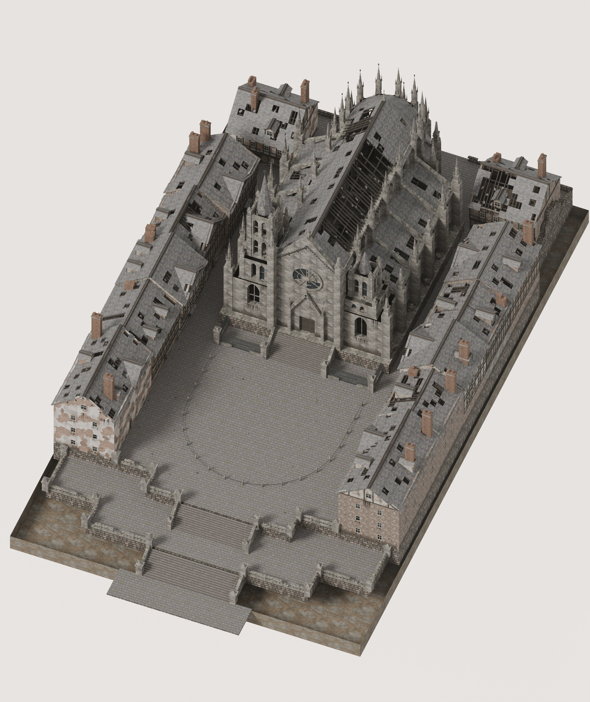
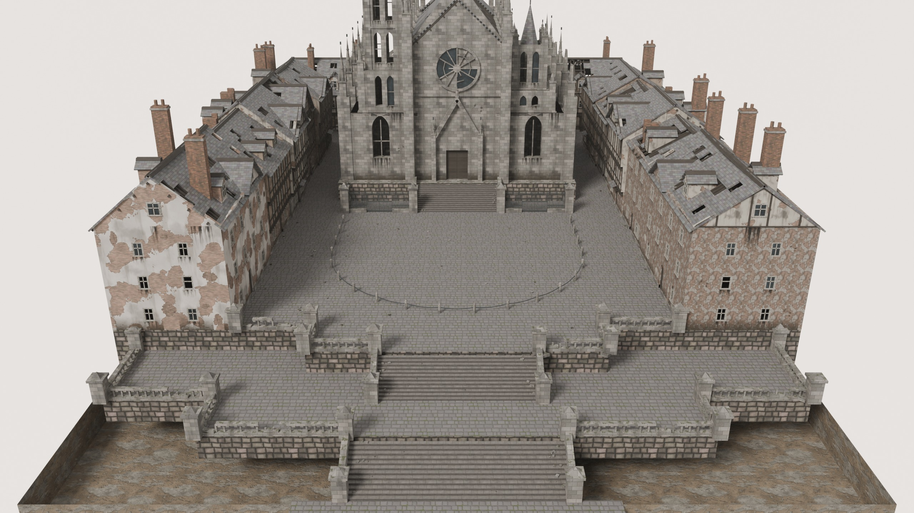
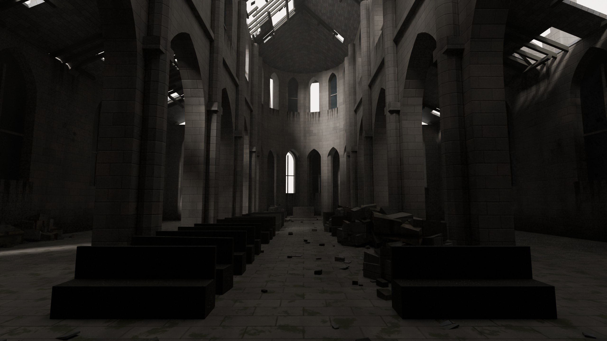
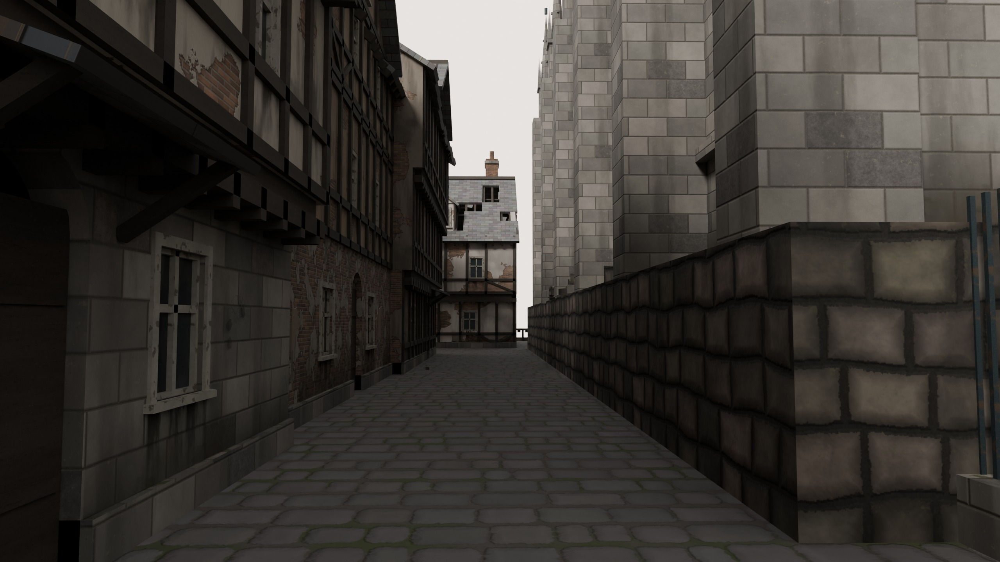
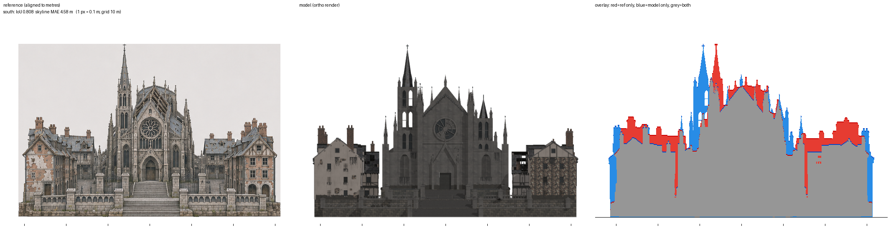
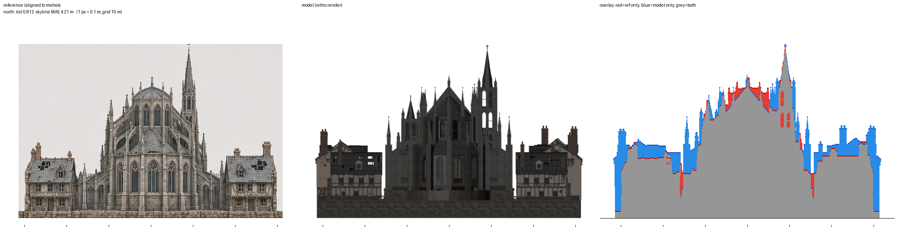

# 哥特建筑群 / Gothic Ruins

根据设计效果图与结构图，用参数化脚本在 Blender 中程序化重建的破败哥特式教堂建筑群，并带 three.js 网页漫游预览。

在线预览：https://gothic-ruins.pages.dev （Cloudflare Pages，推送到 `main` 才更新正式站）。拉取请求会另外发布到同一项目的非生产分支预览，不替换正式站。

当前分支资产含 8 条净宽约 1.40 m 的房屋窄巷，以及台座两侧带 1.10 m 护栏的后巷（北接通、南端封闭）。原 360 真窗、5 盲窗和 125 处缺玻璃未改。正式站在该分支合并前仍是上一版模型。

**当前版本 v1.3 / M13**（2026-11-23）：在 v1.2（M10 外墙贴图 + M11 十字窗 + M12b 1.5 cm 薄石灰壳）基础上，按确认效果将东侧前排房屋 `E4` 南山墙与朝广场临街墙面改为大片灰白旧抹灰与不规则成片裸砖（独立面级材质与连续 8 m UV），其余墙面与几何不变。说明：`docs/renders/` 高清 8 图库本次未重渲，仍对应 v1.2。


漫游模式：WASD 行走、鼠标视角、Space 落地单跳、胶囊体碰撞（three-mesh-bvh）、靠近时自动开合的门。F 或「Fly」进入无碰撞飞行（WASD 平移，Space 上升，C 下降，Shift 加速），切回步行时落到安全地面或回到最近的步行位置。环绕模式可拖拽旋转、滚轮缩放。精确材质名 `Glass`（透明混合）不写深度、不投射阴影，玻璃网格仍参与碰撞；`Glass_blind` 盲窗保持不透明。

## 高清效果图

Cycles 暖光预设渲染（`./render_final.sh` 重渲；仓库里是 JPG，PNG 原图不入库）。**注：本组 8 张高清图库仍为 v1.2（M12b）渲染，M13 本次仅更新顶部 `docs/beauty_iso.png` 与网页预览 `web/building_opt.glb`，未重渲 8 张高清图库。**


| | |
|---|---|
|  等轴测主图 |  黄昏版 |
|  南侧台阶鸟瞰 |  广场人视（玫瑰窗） |
|  主入口 |  中厅内景 |
|  西侧街巷 |  东北看后殿与飞扶壁 |

## 当前比对分数与检查

轮廓重合度（IoU，与设计图正交立面/平面对齐到米后比较）：

| 视图 | IoU | 顶边误差 MAE (m) |
|---|---:|---:|
| 南立面 | 0.808 | 4.58 |
| 北立面 | 0.812 | 4.21 |
| 西立面 | 0.740 | 6.32 |
| 东立面 | 0.748 | 6.17 |
| 平面（场地） | 0.942 | 轮廓 1.19 m |
| 平面（建筑轮廓） | 0.851 | — |

东西两侧分数低于南北，主要是因为图纸本身前后不一致：侧立面把大教堂画得比平面图长约 25 m。布局以平面为准、高度以立面为准；后殿中心往南挪了 3 m，作为侧立面与平面之间的折中（平面图北端会留下约 3 m 未被模型覆盖的月牙）。自动比对循环与手动调整记录见 `compare_log.md`。

- **动线检查**：86 个空间全部可从入口到达；71 处门洞/开口射线全部打穿，其中 69 处侧向射线确认打穿了真实墙体；25 段楼梯踏步高 150–180 mm、踏面至少 260 mm、净空至少 2.1 m，全部合格。反向测试：故意堵住 `W3_door`、把 `W3_stair_01` 一级踏步抬高 60 mm，两项都被检查抓出。详见 `check/circulation_report.md`。
- **实走测试**：无头 Chrome 按 WASD 走完约 287 m（广场、大殿、后殿、钟楼、西排一栋房子的三层），0 次穿墙、0 次卡住，途经 4 扇自动门在通过时均为全开。详见 `walk/walk_result.json`。
- **导出**：当前网页 GLB 为 4,917,968 字节（SHA256 `abb11f6ac7d264f973390fcab03f9ae5b7ab67a9f5ef4d6f298385b008ba2eaa`）。上一版透明玻璃 GLB 为 4,917,564 字节；M13 为 161,143 面、4,810,236 字节。
- **玻璃验证范围**：本机资产流水线已经完整跑过 `./run_all.sh`（Blender 建模、窗洞、两项动线负测、WASD），记录在 `docs/glass-validation.md`。仓库里的 `check/test_aperture_geometry.py`、`check/test_glass_assets.py`、`check/audit_glass_glb.py` 是这条流水线要用的脚本。`run_all.sh` 新增步骤依赖的源文件现已齐全；`building.blend` 与未压缩的 `building.glb` 仍由流水线当场生成，不入库。
- **全窗审计（t22）**：360 个真窗里 235 个已有透明玻璃，125 个因原破败规则整窗缺玻璃，不是不透明玻璃。5 个盲龛和 4 个实心尖顶装饰保持原样。实际几何只修了两处：NW 朝南老虎窗下的原屋顶唇边，以及玫瑰窗洞上跨洞的裂纹贴片。另有 31 个真窗仍被原共墙、飞扶壁、木构、屋檐、烟囱或废墟挡住，其中 6 个近处全挡；这些结构没有删。清单见 `docs/window-audit-t22.md`。网页 GLB 现为 4,917,968 字节，SHA256 `abb11f6ac7d264f973390fcab03f9ae5b7ab67a9f5ef4d6f298385b008ba2eaa`。

并排对照图：





实走截图与轨迹：`docs/walk/`（大殿台阶、中殿、西街，以及 `trajectory.png`）。

## 版本记录

- **v1.3 / M13**（2026-11-23）
  - **E4 双墙面大片剥落覆盖**：经相机投影确认，将东排南端 `E4` 南山墙（外法向 `-Y`）与朝广场临街墙（外法向 `-X`）共 561 个多边形改为独立复制的 `Plaster_d` 材质与连续 8 m 平面 UV（`src/face_materials.py`，参数在 `params.json` 的 `houses.face_material_overrides`），呈大片灰白旧抹灰与成片裸砖；其余 180 个网格对象几何、屋顶、门窗、原贴图、M12b 1.5 cm 薄石灰参数及其他墙面均保持零变化。
  - **校准文件**：补入 `compare/wall/wall_gain.json`，确保仓库内可独立运行 `src/make_textures.py` 复现贴图色彩增益。
  - **检查与构建**：完整 `run_all.sh` 通过（IoU 南 .808 / 北 .812 / 西 .740 / 东 .748，平面 .942、建筑轮廓 .851；动线 86 空间可达、两项负测抓出；WASD 实走 287.3 m 零穿墙/卡住）；`web/building_opt.glb` 为 4,810,236 字节。注：`docs/renders/` 高清 8 图库未随 M13 重渲，仍为 v1.2。
- **v1.2**（2026-11-20）
  - **M10 外墙贴图**：按原始效果图重做所有房屋外墙的灰泥（4 种色调，W4/NW 为大面积剥落露砖）、砖、石、毛石和木构贴图；分区色差 ΔE00 均值 8.36 → 5.67。说明见 `compare/mat/wall_map.md`。
  - **M11 十字窗**：所有房屋窗户改为带竖梃和横档的十字窗，含外框、窗台、内凹玻璃；参数在 `params.json` 的 `houses.windows`，说明见 `compare/mat/window_map.md`。
  - **M12/M12b 石灰在砖外**：修正之前砖块补丁凸出在灰泥表面外的倒置几何。抹灰墙改为墙体内收、外覆 1.5 cm 石灰壳（外轮廓不变），剥落处为带 0.45 cm 斜切断口的洞口，露出内凹的砖面；砖墙临街面加 0.8–1.3 cm 的石灰残片。贴图高度为石灰 > 砖面 > 灰缝，并加入断口接触阴影；法线 1024 px。参数在 `params.json` 的 `houses.plaster_layer`。
  - 检查结果：立面 IoU 南 .808 / 北 .812 / 西 .740 / 东 .748，平面 .942、建筑轮廓 .851；动线 86 个空间全部可达，两项反向测试均抓出；WASD 实走 0 穿墙、0 卡住。
- **v1.1**：高清效果图（`render_final.sh`）。
- **v1.0**：首版程序化建模 + three.js 漫游预览。

## 流程

所有尺寸写在 `params.json`（说明见 `params.md`），几何全部由这份表生成。一键重跑：

```bash
./run_all.sh                    # 用当前参数建模并跑完全部检查
COMPARE_ROUNDS=4 ./run_all.sh   # 先自动比对调参若干轮，再建模检查
FAST=1 ./run_all.sh             # 跳过 Cycles 效果图
```

步骤如下：

1. **读图拆参数** — 从设计图裁出参考面板（`ref/`），写成 `params.json`。房屋分户明细见 `houses_table.md`。贴图由 `src/make_textures.py` 按参数生成到 `tex/`。
2. **自动比对循环** — `compare/compare_loop.py` 用正交相机渲染四个立面和俯视图，与设计图轮廓比 IoU 和顶边误差，按差最大的地方改参数、重新建模，多轮结果记在 `compare_log.md`。部分高度（大殿檐口、尖塔等）已锁定，循环不会再改。
3. **Blender 程序化建模** — `build.py` + `src/geom.py` 在 Blender 后台按尺寸生成教堂、后殿、尖塔、房子室内（楼梯与隔墙按常规补全）、破败效果（塌顶、断尖顶、碎窗花、碎石等）和场景。
4. **动线检查** — `check/circulation_check.py`：空间为节点，门、楼梯等为连线；BFS 检查从入口是否可达每一空间；门洞射线确认打穿墙体；楼梯逐级检查踏步高度、踏面深度和头顶净空。并做反向测试（堵门、抬踏步），确认检查能发现问题。
5. **导出** — gltf-transform 把贴图转成 WebP、几何用 Meshopt 压缩，得到 `web/building_opt.glb`。
6. **网页预览** — three.js（环绕 / 漫游），碰撞用 three-mesh-bvh，自动门由脚本控制开合。依赖已放到 `web/vendor/`，静态托管即可运行，无需 `node_modules`。
7. **实走测试** — `walk/walk_test.py` 用无头 Chrome 打开预览页，模拟按 WASD 走完整条路线，记录轨迹，再用射线确认全程没有穿墙、没有卡住。

每次改脚本后应重新生成并跑完比对、动线和实走，避免把别处改坏。

依赖：Blender 5.x，Python 3（numpy、Pillow 等），Node + `@gltf-transform/cli`，Chrome / Playwright。

## 本地预览

```bash
cd web && python3 -m http.server 8766
# 打开 http://localhost:8766/
```

操作：右上角切换「环绕 / 漫游 / 飞行」。漫游用 WASD、点击锁定鼠标视角（Esc 释放）、Shift 奔跑、Space 在着地时跳一次。飞行用 F 或 Fly：WASD 水平移动，Space 上升，C 下降，Shift 加速，可穿过建筑观察；再按 F、Walk 或 Tab 时，脚下落到空旷地面，否则回到最近的安全步行位置。靠近门约 3.2 m 时自动打开（飞行时不打开）。窄屏另有跳跃或升降按钮。

## 目录

- `web/` — 静态站点（部署目录）：`index.html`、`main.js`、`building_opt.glb`、`spaces.json`、`vendor/`
- `build.py`、`src/` — Blender 生成与渲染脚本
- `params.json`、`params.md`、`houses_table.md` — 参数表
- `compare/` — 轮廓比对、调参循环、材质脚本（`compare/mat/`）
- `check/` — 动线 / 门洞 / 楼梯检查
- `walk/` — 无头 Chrome 实走测试
- `ref/` — 从设计图裁出的参考面板
- `tex/` — 无缝贴图（石、瓦、砖、灰泥等）
- `docs/` — 效果图、立面对照、实走截图
- `ruin_streams.json` — 破败效果的固定随机流，保证可复现
- `run_all.sh` — 一键流水线

未纳入本仓库的大文件：原始 `building.blend` / `building.glb`、`tmp/`、`logs/`、`compare/work/` 等中间结果。

部署方式与 [cyber-louvre](https://github.com/xuzhiming/cyber-louvre) 相同：推送 `main` → GitHub Actions → Cloudflare Pages。
