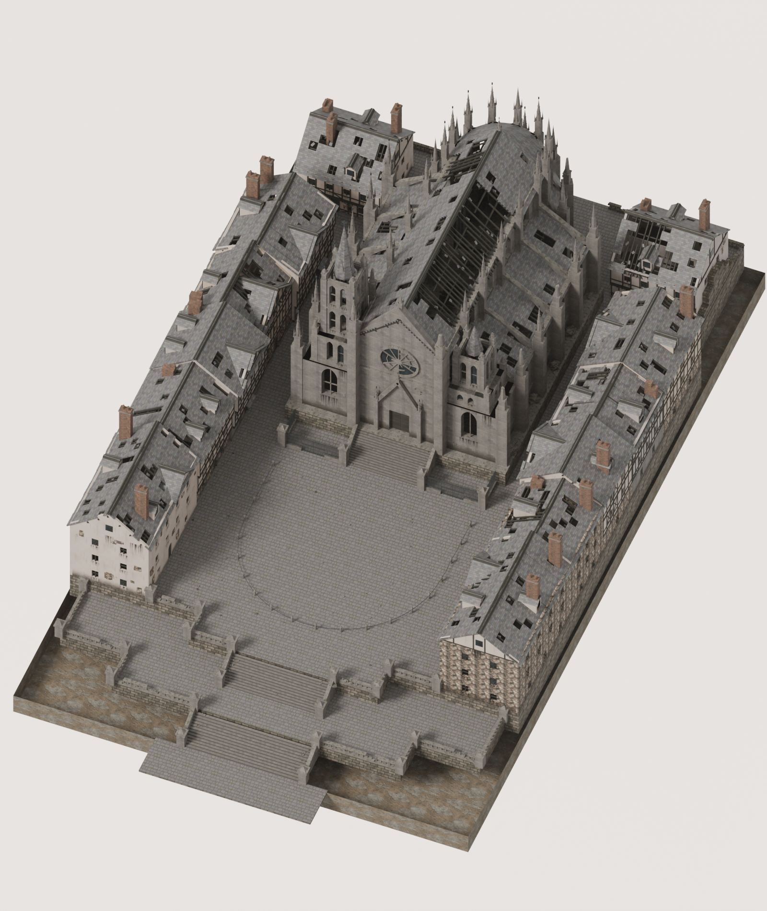
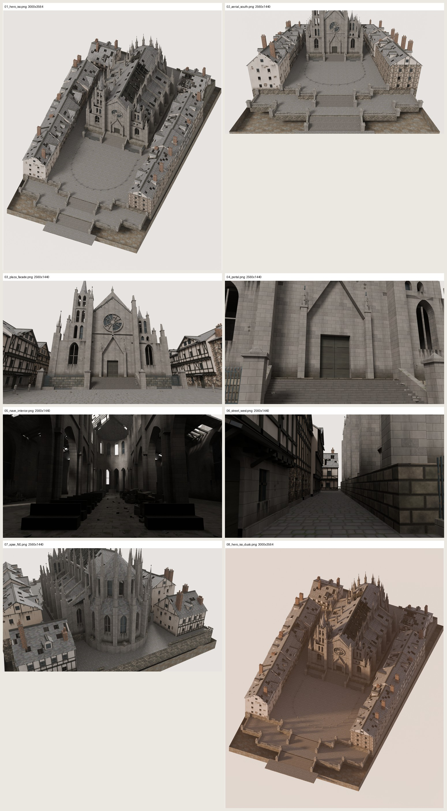
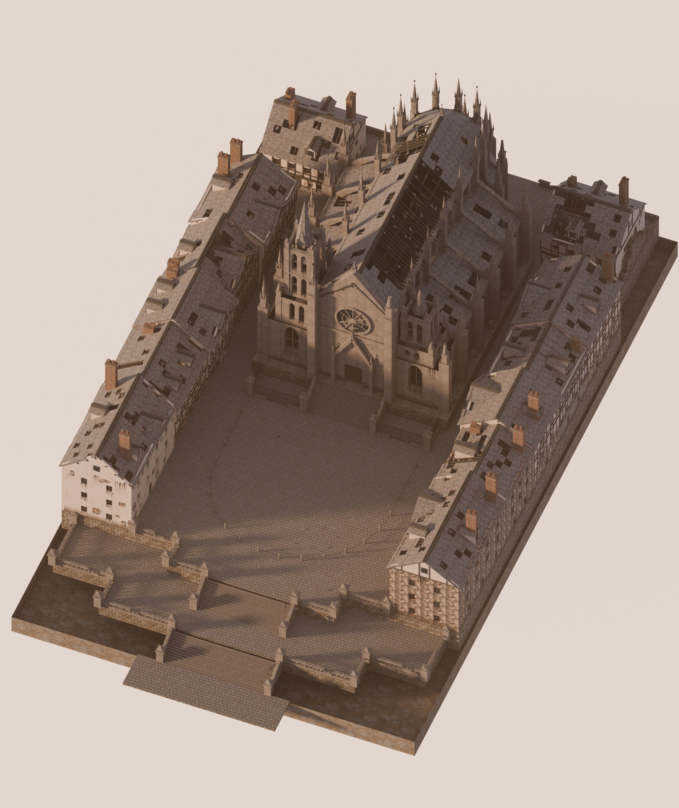
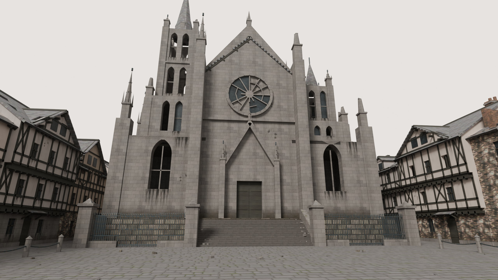
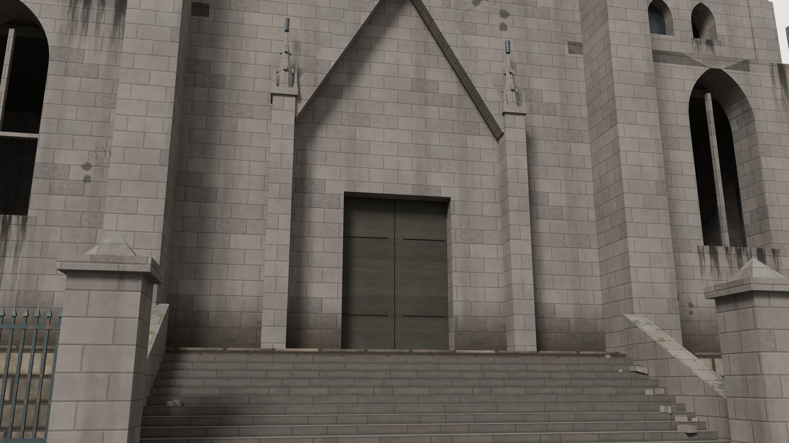
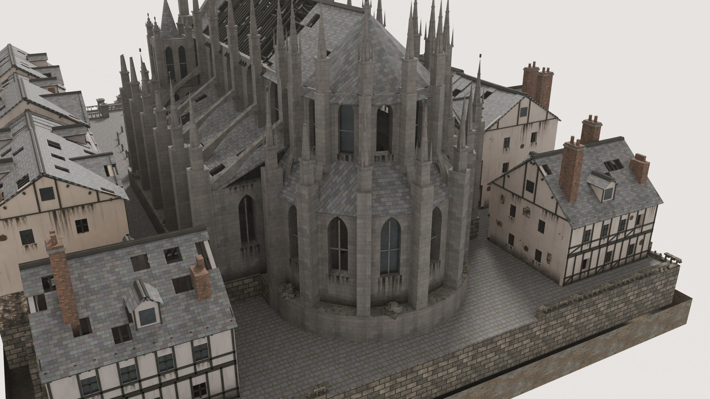
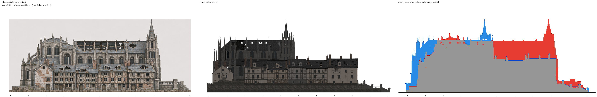
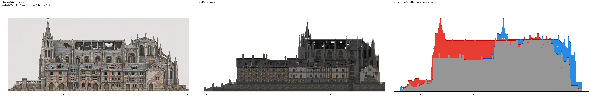
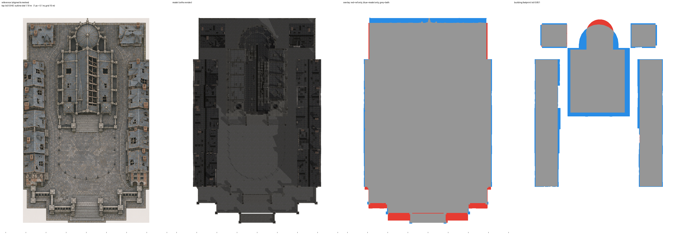

# 哥特建筑群 / Gothic Ruins

根据设计效果图与结构图，用参数化脚本在 Blender 中程序化重建的破败哥特式教堂建筑群，并带 three.js 网页漫游预览。

在线预览：https://gothic-ruins.pages.dev （Cloudflare Pages，每次推送到 `main` 从 `web/` 自动部署）



漫游模式：WASD 行走、鼠标视角、胶囊体碰撞（three-mesh-bvh）、靠近时自动开合的门。环绕模式可拖拽旋转、滚轮缩放。

## 高清效果图

Cycles 暖光预设渲染（`./render_final.sh` 重渲；仓库里是 JPG，PNG 原图不入库）。



| | |
|---|---|
|  等轴测主图 |  黄昏版 |
|  南侧台阶鸟瞰 |  广场人视（玫瑰窗） |
|  主入口 |  中厅内景 |
|  西侧街巷 |  东北看后殿与飞扶壁 |

## 当前比对分数与检查

轮廓重合度（IoU，与设计图正交立面/平面对齐到米后比较）：

| 视图 | IoU | 顶边误差 MAE (m) |
|---|---:|---:|
| 南立面 | 0.808 | 4.58 |
| 北立面 | 0.812 | 4.22 |
| 西立面 | 0.741 | 6.32 |
| 东立面 | 0.748 | 6.17 |
| 平面（场地） | 0.942 | 轮廓 1.19 m |
| 平面（建筑轮廓） | 0.851 | — |

东西两侧分数低于南北，主要是因为图纸本身前后不一致：侧立面把大教堂画得比平面图长约 25 m。布局以平面为准、高度以立面为准；后殿中心往南挪了 3 m，作为侧立面与平面之间的折中（平面图北端会留下约 3 m 未被模型覆盖的月牙）。自动比对循环与手动调整记录见 `compare_log.md`。

- **动线检查**：86 个空间全部可从入口到达；71 处门洞/开口射线全部打穿，其中 69 处侧向射线确认打穿了真实墙体；25 段楼梯踏步高 150–180 mm、踏面至少 260 mm、净空至少 2.1 m，全部合格。反向测试：故意堵住 `W3_door`、把 `W3_stair_01` 一级踏步抬高 60 mm，两项都被检查抓出。详见 `check/circulation_report.md`。
- **实走测试**：无头 Chrome 按 WASD 走完约 287 m（广场、大殿、后殿、钟楼、西排一栋房子的三层），0 次穿墙、0 次卡住，途经 4 扇自动门在通过时均为全开。详见 `walk/walk_result.json`。
- **导出**：原始 GLB 约 23.4 MB，经 gltf-transform（贴图转 WebP、几何 Meshopt）后 `web/building_opt.glb` 约 3.72 MB。

并排对照图：






实走截图与轨迹：`docs/walk/`（大殿台阶、中殿、西街，以及 `trajectory.png`）。

## 流程

所有尺寸写在 `params.json`（说明见 `params.md`），几何全部由这份表生成。一键重跑：

```bash
./run_all.sh                    # 用当前参数建模并跑完全部检查
COMPARE_ROUNDS=4 ./run_all.sh   # 先自动比对调参若干轮，再建模检查
FAST=1 ./run_all.sh             # 跳过 Cycles 效果图
```

步骤如下：

1. **读图拆参数** — 从设计图裁出参考面板（`ref/`），写成 `params.json`。房屋分户明细见 `houses_table.md`。贴图由 `src/make_textures.py` 按参数生成到 `tex/`。
2. **自动比对循环** — `compare/compare_loop.py` 用正交相机渲染四个立面和俯视图，与设计图轮廓比 IoU 和顶边误差，按差最大的地方改参数、重新建模，多轮结果记在 `compare_log.md`。部分高度（大殿檐口、尖塔等）已锁定，循环不会再改。
3. **Blender 程序化建模** — `build.py` + `src/geom.py` 在 Blender 后台按尺寸生成教堂、后殿、尖塔、房子室内（楼梯与隔墙按常规补全）、破败效果（塌顶、断尖顶、碎窗花、碎石等）和场景。
4. **动线检查** — `check/circulation_check.py`：空间为节点，门、楼梯等为连线；BFS 检查从入口是否可达每一空间；门洞射线确认打穿墙体；楼梯逐级检查踏步高度、踏面深度和头顶净空。并做反向测试（堵门、抬踏步），确认检查能发现问题。
5. **导出** — gltf-transform 把贴图转成 WebP、几何用 Meshopt 压缩，得到 `web/building_opt.glb`。
6. **网页预览** — three.js（环绕 / 漫游），碰撞用 three-mesh-bvh，自动门由脚本控制开合。依赖已放到 `web/vendor/`，静态托管即可运行，无需 `node_modules`。
7. **实走测试** — `walk/walk_test.py` 用无头 Chrome 打开预览页，模拟按 WASD 走完整条路线，记录轨迹，再用射线确认全程没有穿墙、没有卡住。

每次改脚本后应重新生成并跑完比对、动线和实走，避免把别处改坏。

依赖：Blender 5.x，Python 3（numpy、Pillow 等），Node + `@gltf-transform/cli`，Chrome / Playwright。

## 本地预览

```bash
cd web && python3 -m http.server 8766
# 打开 http://localhost:8766/
```

操作：右上角切换「环绕 / 漫游」；漫游模式用 WASD 移动、点击锁定鼠标视角（Esc 释放）、Shift 奔跑。靠近门约 3.2 m 时自动打开。

## 目录

- `web/` — 静态站点（部署目录）：`index.html`、`main.js`、`building_opt.glb`、`spaces.json`、`vendor/`
- `build.py`、`src/` — Blender 生成与渲染脚本
- `params.json`、`params.md`、`houses_table.md` — 参数表
- `compare/` — 轮廓比对、调参循环、材质脚本（`compare/mat/`）
- `check/` — 动线 / 门洞 / 楼梯检查
- `walk/` — 无头 Chrome 实走测试
- `ref/` — 从设计图裁出的参考面板
- `tex/` — 无缝贴图（石、瓦、砖、灰泥等）
- `docs/` — 效果图、立面对照、实走截图
- `ruin_streams.json` — 破败效果的固定随机流，保证可复现
- `run_all.sh` — 一键流水线

未纳入本仓库的大文件：原始 `building.blend` / `building.glb`、`tmp/`、`logs/`、`compare/work/` 等中间结果。

部署方式与 [cyber-louvre](https://github.com/xuzhiming/cyber-louvre) 相同：推送 `main` → GitHub Actions → Cloudflare Pages。
